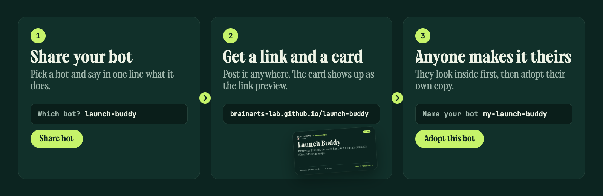
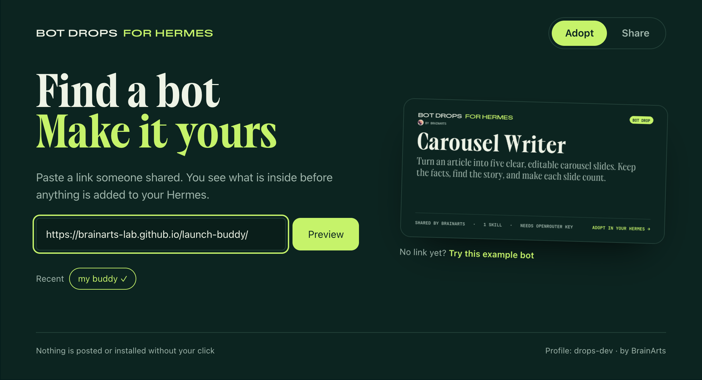
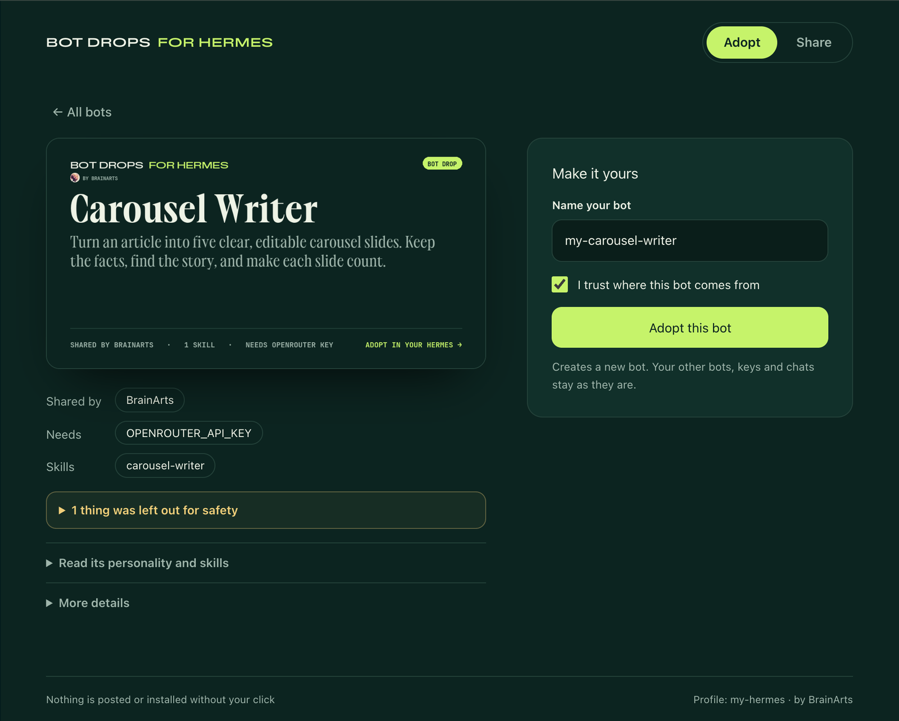
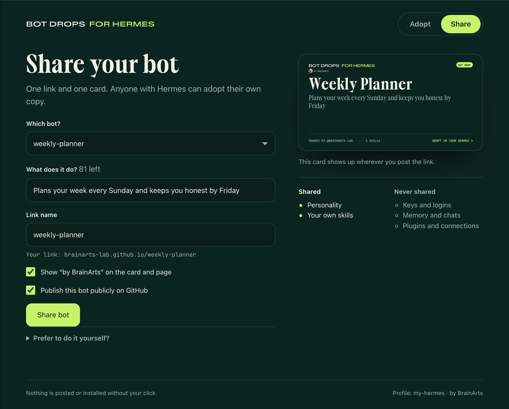
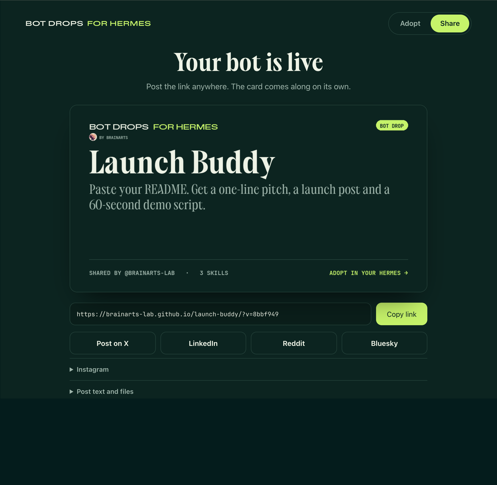

# Bot Drops for Hermes

Share a Hermes bot as a link and a card. Anyone with Hermes can preview it and adopt their own copy as a new profile.



Made by BrainArts · [@chrisbrainarts on X](https://x.com/chrisbrainarts) · MIT licensed

## Try it

[](https://brainarts-lab.github.io/launch-buddy/)

[Launch Buddy](https://brainarts-lab.github.io/launch-buddy/) is a small bot we shared with Bot Drops: paste your README and it answers with a one-line pitch, a launch post and a 60-second demo script. Install the plugin, paste the link `https://brainarts-lab.github.io/launch-buddy/` into Bot Drops, and it is yours.

## What it does

**Adopt a bot.** Open a bot link, or paste it into Bot Drops. You see the bot's card, what it needs and what was left out, before anything is installed. Adopting always creates a **new** Hermes profile through Hermes' own `hermes profile install`, pinned to the exact commit you reviewed. Existing profiles, including `default`, are never changed. The adopted bot runs with your own model access; the sharer's keys and logins never travel with it.

| Find a bot | Look before you adopt |
| --- | --- |
|  |  |

**Share your bot.** Pick one of your bots, say in one line what it does and watch its card build itself. *Share bot* packages the personality (`SOUL.md`) and your own text skills, renders a link card (1200 × 630) and a story image (1080 × 1920), creates a new public GitHub repository through your own `gh` login, uploads the package and turns on GitHub Pages. You get one link, with share buttons for X, LinkedIn, Reddit and Bluesky. Link previews show the card automatically. *Update a drop* publishes a new version to a drop you shared earlier.

| Share | Live |
| --- | --- |
|  |  |

**The bot page.** Every shared bot gets a small page on GitHub Pages. *Adopt in my Hermes* opens Hermes Desktop straight into the preview (`hermes://drops/import?url=…`). On a phone the page offers a message for your Hermes chat instead.

**Never shared:** keys and logins (`.env`, `auth.json`), settings (`config.yaml` apart from the name of a built-in model), memory, chats and sessions, plugins, MCP servers, custom endpoints, skills that ship with Hermes, and skill programs or attachments. A key pasted into the personality or a skill blocks sharing.

## Install

```sh
hermes plugins install https://github.com/brainarts-lab/bot-drops --enable
```

Requires Hermes `>=0.23.0`. No extra Python packages: Bot Drops uses Pillow and ruamel.yaml, which ship with Hermes. Publishing to GitHub needs the [GitHub CLI](https://cli.github.com/) signed in (`gh auth login`); without it, Bot Drops prepares the files for a manual upload.

Then open **Bot Drops** in the Hermes dashboard (`/drops/import`) or in Hermes Desktop (Capabilities → Plugins → Bot Drops).

## In chat

You can also talk to your Hermes, for example from Telegram:

```text
/drop preview https://github.com/<owner>/<bot>
/drop install <preview id> --name my-bot
/drop example
```

Or just ask: "Show me this bot: <link>". Installing always asks for a confirmation first.

## What the plugin does on your machine

So you can decide before installing:

- **Network:** a preview clones a *public* GitHub/GitLab repository (HTTPS only, size, time and file limits, no symlinks or submodules). Publishing calls GitHub through your `gh` login, and only when you press *Share bot* or *Update drop*.
- **Programs it runs:** `git`, `gh` and `hermes profile install`, always as fixed argument lists, never through a shell.
- **Files it reads:** the profile you choose to share, and that profile's `.env` and `auth.json` only to make sure none of their values end up in the package. It writes to its own folder `plugin-data/bot-drops` and creates new profiles only when you adopt. Previews that were not adopted are removed after 24 hours, local share packages after 7 days.
- **No telemetry.** Shared pages and cards carry a small "Made with Bot Drops · by BrainArts" line linking to [@chrisbrainarts](https://x.com/chrisbrainarts). It is a plain link without tracking, and you can turn it off before sharing.

Profiles are not a security sandbox: a bot's personality and skills guide your agent. Only adopt bots from people you trust.

## Limits

- Built and tested on macOS. Linux and native Windows run the same code; file locking, process cleanup, paths and Git's certificate store are handled per system. Windows support is new in 0.5.0 and has not been confirmed on a Windows machine yet, so please report what you see.
- On Hermes 0.23.0, a bot name you removed earlier cannot be used again for a new bot; Bot Drops suggests a free name. Hermes 0.23.1 lifts this.
- Opening a link on a phone cannot jump into Hermes directly. The bot page offers a message for your Hermes chat instead.
- Hermes Desktop support covers local Hermes sources.
- Shared bots are public repositories. Private sharing is not supported.

## Development

```sh
python -m pip install "Pillow==13.0.0" "ruamel.yaml==0.18.16" "fastapi>=0.115,<0.120" "httpx>=0.27,<1"
python -m unittest discover -s tests -v
node --test tests/test_drops_ui.cjs
python scripts/build-ui.py   # rebuilds dashboard/dist/index.js and desktop/plugin.js from ui/
python scripts/check-live-preview.py https://brainarts-lab.github.io/launch-buddy/   # previews a live bot, installs nothing
```

The GitHub tests use a stand-in `gh` and local bare repositories; they never contact GitHub.
